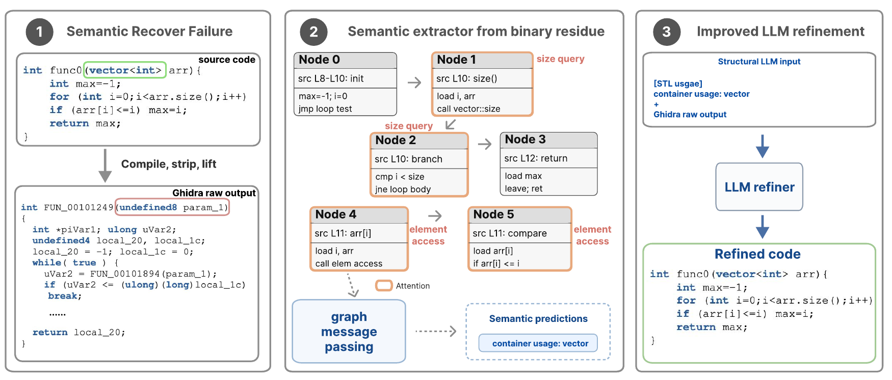
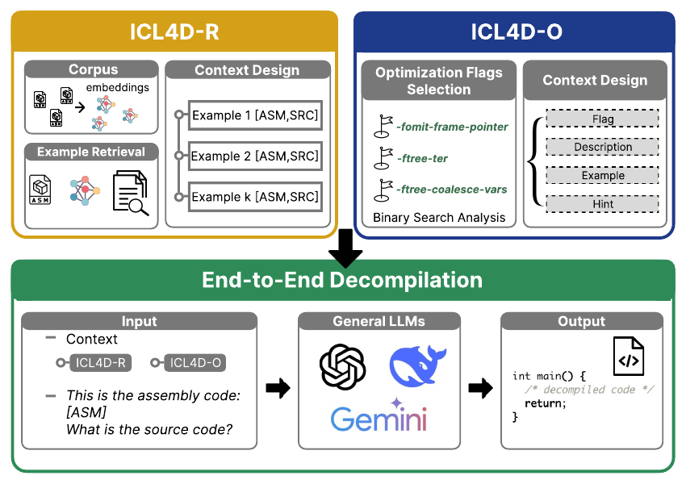
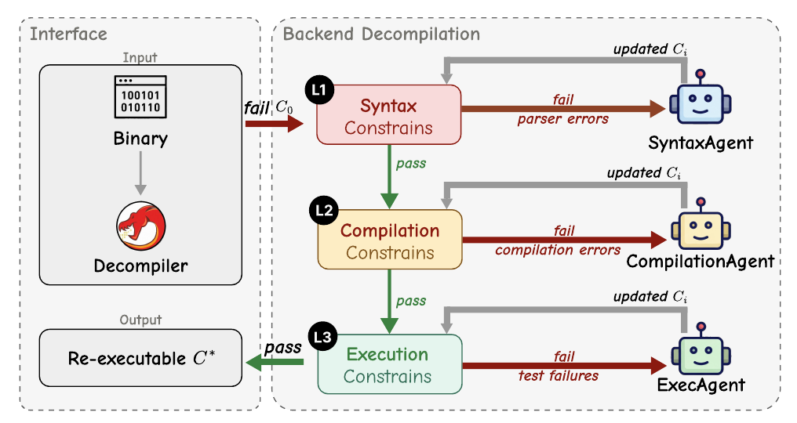
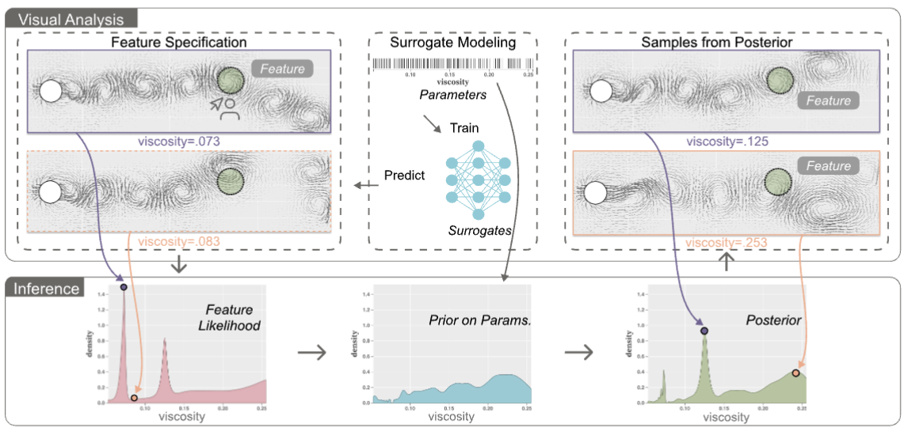
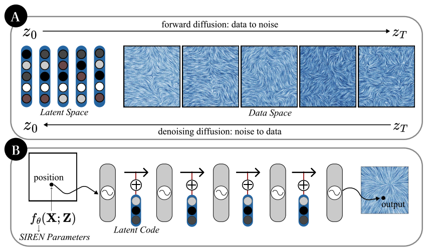
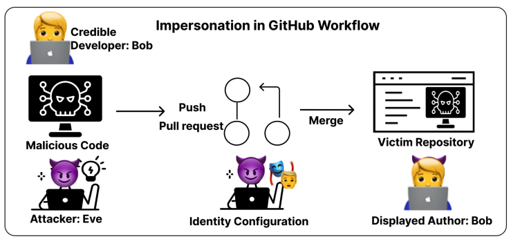
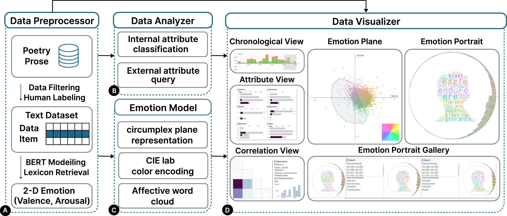

  

    I am <strong>Xiaohan Wang</strong>, a Ph.D. student in Computer Science at <strong>Vanderbilt University</strong>, advised by <a href="https://kjl.name/">Kevin Leach</a>.
    My research centers on reliable LLM-assisted decompilation and binary analysis, combining semantic recovery, program analysis, and behavioral feedback to reconstruct readable, executable code from compiled binaries.
  

  

    As a Graduate Research Assistant at Vanderbilt, I contribute to healthcare cybersecurity and autonomous defense efforts under the <strong>ARPA-H DIGIHEALS</strong> and <strong>ARPA-H UPGRADE</strong> programs. Earlier in my Ph.D. and undergraduate studies, I worked on machine learning for scientific visualization and neural field exploration with Prof. Matthew Berger, and held research internships at HKUST and the Shandong Future Network Research Institute.
  

  <section class="about-column">
    <h2 class="about-column__title">Education</h2>
    <ul class="about-education">
      <li class="about-education__item">
        
Ph.D. in Computer Science

        
Vanderbilt University

        
Aug 2023 – Expected May 2028

      </li>
      <li class="about-education__item">
        
B.Eng. in Software Engineering

        
Nanjing Normal University, Yingcai Honors College

        
Sep 2019 – Jun 2023

      </li>
    </ul>
  </section>

  <section class="about-column">
    <h2 class="about-column__title">Research Interests</h2>
    <ul class="about-interests">
      <li>Code and program understanding with large language models</li>
      <li>Large-scale scientific simulation data exploration using machine learning techniques</li>
    </ul>
  </section>

<section class="about-section about-section--publications">
  <h2>Selected Publications</h2>

  <ul class="pub-list">
    <li class="pub-item">
      
      

        
STILL: Recovering Lowered STL Semantics for LLM-assisted C++ Decompilation

        
<strong>Xiaohan Wang</strong>, Kevin Leach

        

          EMNLP 2026 Main Conference
          &middot; 2026
        

        

          <a href="https://arxiv.org/abs/2608.26408">arXiv</a>
        

      

    </li>

    <li class="pub-item">
      
      

        
ICL4Decomp: Towards Re-executable Reverse Engineering

        
<strong>Xiaohan Wang</strong>, Yuxin Hu, Kevin Leach

        

          Findings of EMNLP 2026
          &middot; 2026
        

        

          <a href="https://arxiv.org/abs/2511.01763">arXiv</a>
        

      

    </li>

    <li class="pub-item">
      
      

        
Constraint-Guided Multi-Agent Decompilation for Executable Binary Recovery

        
Yifan Zhang*, <strong>Xiaohan Wang*</strong>, Yueke Zhang, Yu Huang, Kevin Leach

        
*Equal contribution.

        

          NeurIPS 2026 Workshop on Evaluation of Interactive Agents
          &middot; 2026
        

        

          <a href="https://arxiv.org/abs/2604.23940v2">arXiv</a>
        

      

    </li>

    <li class="pub-item">
      
      

        

          Seeing the Many: Exploring Parameter Distributions Conditioned on Features in Surrogates
          Best Paper Award
        

        
<strong>Xiaohan Wang</strong>, Zhimin Li, Joshua A. Levine, and Matthew Berger

        

          IEEE Workshop on Uncertainty Visualization
          &middot; 2025
        

      

    </li>

    <li class="pub-item">
      
      

        
Topology Guidance: Controlling the Outputs of Generative Models via Vector Field Topology

        
<strong>Xiaohan Wang</strong> and Matthew Berger

        

          arXiv preprint
          &middot; 2025
        

        

          <a href="https://arxiv.org/pdf/2505.06804">arXiv</a>
        

      

    </li>

    <li class="pub-item">
      
      

        
Who's Pushing the Code? An Exploration of GitHub Impersonation

        
Yueke Zhang, Anda Liang, <strong>Xiaohan Wang</strong>, ..., Kevin Leach, and Yu Huang

        

          IEEE/ACM International Conference on Software Engineering (ICSE)
          &middot; 2025
        

        

          <a href="https://yuhuang-lab.github.io/paper/ICSE25_Github_camera.pdf">Paper</a>
        

      

    </li>

    <li class="pub-item">
      
      

        
EmotionLens: Interactive visual exploration of the circumplex emotion space in literary works via affective word clouds

        
Bingyuan Wang, Qing Shi, <strong>Xiaohan Wang</strong>, You Zhou, ..., and Zeyu Wang

        

          Visual Informatics
          &middot; 2025
        

        

          <a href="https://www.sciencedirect.com/science/article/pii/S2468502X25000063">Paper</a>
        

      

    </li>
  </ul>
</section>

<section class="about-section">
  <h2>Projects</h2>

  <ul class="project-list">
    <li class="project-item">
      

        
ARPA-H UPGRADE — Universal PatchinG and Remediation for Autonomous DEfense

        Graduate Research Assistant &middot; Vanderbilt University
      

      

        Contributing to autonomous cyber-defense and automated vulnerability remediation for hospital IT environments and clinical infrastructure, enabling assured patching without disrupting patient care.
      

    </li>

    <li class="project-item">
      

        
ARPA-H DIGIHEALS — Digital Health Security

        Graduate Research Assistant &middot; Vanderbilt University
      

      

        Conducting research on binary analysis, reverse engineering, and automated security assurance to strengthen the resilience of digital health applications and medical software systems.
      

    </li>
  </ul>
</section>

<section class="about-section">
  <h2>News</h2>

  <ul class="minimal-list">
    <li class="minimal-list__item">
      Sep 2026
      

        Our paper <em>“Constraint-Guided Multi-Agent Decompilation for Executable Binary Recovery”</em> has been accepted to NeurIPS 2026 Workshop on Evaluation of Interactive Agents.
      

    </li>

    <li class="minimal-list__item">
      Aug 2026
      

        Our paper <em>“STILL: Recovering Lowered STL Semantics for LLM-assisted C++ Decompilation”</em> has been accepted to EMNLP 2026 Main Conference.
      

    </li>

    <li class="minimal-list__item">
      Aug 2026
      

        Our paper <em>“ICL4Decomp: Towards Re-executable Reverse Engineering”</em> has been accepted to Findings of EMNLP 2026.
      

    </li>

    <li class="minimal-list__item">
      Nov 2025
      

        Our paper <em>“Seeing the Many: Exploring Parameter Distributions Conditioned on Features in Surrogates”</em> is accepted and received the Best Paper Award at the IEEE Workshop on Uncertainty Visualization.
      

    </li>

    <li class="minimal-list__item">
      May 2025
      

        Our work <em>“Topology Guidance: Controlling the Outputs of Generative Models via Vector Field Topology”</em> is released as an arXiv preprint.
      

    </li>

    <li class="minimal-list__item">
      Mar 2025
      

        Our collaborative project <em>“EmotionLens: Interactive visual exploration of the circumplex emotion space in literary works via affective word clouds”</em> is published in <em>Visual Informatics</em>.
      

    </li>

    <li class="minimal-list__item">
      Mar 2025
      

        Our paper <em>“Who's Pushing the Code? An Exploration of GitHub Impersonation”</em> is accepted by ICSE.
      

    </li>

    <li class="minimal-list__item">
      2025
      

        I began a new research direction under the guidance of Prof. Leach.
      

    </li>

    <li class="minimal-list__item">
      Nov 2024
      

        I passed my Ph.D. preliminary examination.
      

    </li>

    <li class="minimal-list__item">
      Aug 2023
      

        I started my Ph.D. in Computer Science at Vanderbilt University under the supervision of Prof. Berger.
      

    </li>

    <li class="minimal-list__item">
      2020
      

        I was selected for Yingcai Honors College.
      

    </li>
  </ul>
</section>

<section class="about-section">
  <h2>Awards</h2>

  <ul class="minimal-list">
    <!-- <li class="minimal-list__item">
      2025
      

        Best Long Paper Award of IEEE Workshop on Uncertainty Visualization
      

    </li> -->
    <li class="minimal-list__item">
      2020 – 2022
      

        Outstanding Student Scholarship — First Prize
        <small>Top 5% of cohort</small>
      

    </li>
  </ul>
</section>
